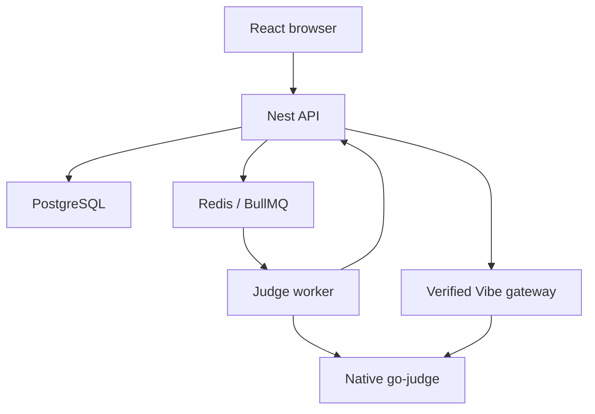

# Consolidated architecture

## Runtime responsibilities

| Area | Responsibility | Source |
|---|---|---|
| React application | Role-aware routes, authenticated API calls, code editor, community, learning and enterprise/Vibe workspaces | [Front/src](../../Front/src) |
| Nest API | Authentication and ownership, problem/version management, submissions and scoring, learning, community and operator endpoints | [Back/src/modules](../../Back/src/modules) |
| PostgreSQL | Durable users/sessions, immutable assessment bindings, attempts/results, solve/XP ledger, goals and migration ledger | [Database and 31 migrations](../../Back/src/database) |
| Redis/BullMQ | Bounded admission, queued execution and recovery coordination | [Submission services](../../Back/src/modules/submissions), [worker](../../Judge/src/worker.ts) |
| Judge worker | Claim/fencing, compilation/execution protocol, output bounds, result replay and cleanup | [Judge/src](../../Judge/src) |
| Native executor | Eight language runtimes and existing resource/isolation contract | [Judge/runtime](../../Judge/runtime) |
| Vibe transport | Public/private fixture separation, pinned workspace/assessment content, verified TLS/mTLS gateway transport | [Vibe](../../Back/src/modules/vibe), [dedicated gateway template](../../Judge/deploy/vibe) |

The API has twelve domain modules: auth, admin, community, email, enterprise,
health, missions, notifications, problems, submissions, users and Vibe. Shared
infrastructure remains separate from those domain contracts. No framework or
database rewrite is introduced by consolidation.

The diagram shows logical calls. Dedicated host, network, firewall, certificates
and actual privilege separation require operational evidence; a template or
disposable Compose run does not establish production topology.

## Correctness boundaries retained

Authentication at request entry identifies the principal. A mutation that waits
on a database lock also needs a current actor check when a concurrent revocation
could win before its write. The consolidation's narrow actor helper locks the
user with `FOR NO KEY UPDATE`, checks current account/token state and then reads
session-family validity in a fresh statement. Foreign-key `KEY SHARE` compatibility
and domain-specific lock order are preserved. This is an explicit fence for the
audited mutation paths, not a claim that all already-started requests everywhere
are cancelled on logout.

Assessment and Vibe content are pinned to immutable versions. Results, summaries,
CSV and history must use the same retained definition even after an author edits
the current problem. User learning uses eligible distinct public ordinary solves;
private, enterprise and test-only activity does not leak into public progress.

Submissions preserve generation and lease checks, idempotent final callbacks,
current-verdict problem statistics and unique accepted-solve XP. Rejudging is not
a second independent XP award. Existing transactions and migration guards remain
the source of truth for these invariants.

Frontend request ownership distinguishes a routine bearer refresh from a new
login/account identity. Routine refresh should retain an active form and its
successful completion; account replacement must discard private state and stale
callbacks. Shared navigation ownership is separate from either token identity.

Native execution remains an untrusted-code boundary. App/worker files, privileged
executor files, hidden fixtures and credentials must stay distinct. Cleanup accepts
only bounded, validated artifact identifiers and runs on failure paths as well as
successful responses. Output and verdict semantics remain unchanged.

## Deliberately retained structure

The existing large service modules are not mechanically split solely to reduce
line counts. Small shared actor/request helpers remove demonstrated duplication
without moving transaction ownership or error contracts across broad new layers.
No new runtime dependency, migration, public API shape or speculative product
feature is required for the final quality corrections.
