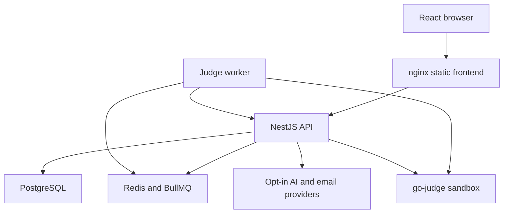

# Architecture and feature inventory

Baseline: `6176015b63a1615cc2269172f246725ef08abab3`.
The generated inventory contains 453 tracked files, 112 API method/path combinations across 13 controller files, 35 frontend route declarations, 25 migrations, and 30 CREATE TABLE declarations. These are structural counts, not a coverage percentage. See `INVENTORY.json` for exact paths and dependency versions.

## Service topology

Vite builds route-split React/TypeScript assets. The frontend uses a bearer access token and refresh-token family, API wrappers, custom code editor, sanitized Markdown and mathematical rendering. nginx proxies `/api/`; the API mounts `/api/v1` and a separate Swagger document.

NestJS contains auth, users, problems, submissions, enterprise assessments, community, notifications, missions, vibe coding, email, administration and health modules. TypeORM maps core entities; many newer modules intentionally use parameterized SQL for transactions and relational projections. Schema synchronization is disabled; migrations define the database contract. A Redis Lua-backed global throttler shares rate limits between API replicas.

## Feature map

| Domain | Actual features and principal sources |
|---|---|
| Accounts | Registration/login; rotating refresh families; password/username changes; session list/revocation; temporary-password restriction; suspension; withdrawal/anonymization. `Back/src/modules/auth`, `users`, account/email frontend pages. |
| Problems | Authoring, samples/private cases, moderation/status, visibility, version snapshots, tags/editorials, search/filter/pagination, BOJ and starter imports. `problems`, `Back/scripts`. |
| Submissions | Eight languages, submission quotas, asynchronous judging, test-only execution, result details, rejudge/cancel, cursor pagination, learning evidence and XP reconciliation. `submissions`. |
| Enterprise | Owner-created scheduled assessments, link/name/email invitations, fixed task lists, attempt deadlines and finish, hidden candidate scores, owner results, algorithm and vibe tasks, revision/evaluation review. `enterprise`. |
| Community | Posts/comments, votes, accepted answers, saves/follows, views, reports/moderation, notifications. `community`, `notifications`. |
| Learning | Missions, badges, analysis questions and attempts, XP/rankings/profile. `missions`, `analysis`, `users`. |
| Vibe coding | Versioned project files, AI-assisted edits, sandbox compile/run, public/hidden checks, submission report, enterprise revisions and evaluation. `vibe`. |
| Email/privacy | Verified email, notification preferences, unsubscribe tokens, encrypted leased outbox, retry/rate controls, withdrawal effects. `email`. |
| Operations | Admin audit/roles/suspension/queue metrics; dependency health; recovery timers; deployment checks; backup sidecar; pinned CI. `admin`, `health`, `deploy`, `.github`, `scripts`. |

## Submission state and data flow

1. JWT strategy reloads the current account and, when present, live refresh family; guards enforce role/resource policy.
2. Submission creation checks problem/assessment eligibility and quotas, persists a version reference and `QUEUED` row, then enqueues a generation-specific BullMQ job.
3. Worker authenticates to the internal API and claims with generation and attempt ID. API stores a timed lease and returns an immutable problem snapshot including private cases.
4. Worker checks Linux/cgroup/seccomp readiness, compiles and runs each case through go-judge with CPU/wall/memory/output/process budgets and bounded artifact cleanup.
5. Result callback is fenced by generation/attempt and serialized on the submission row. It records final status, per-case metadata and permitted diagnostics, then reconciles solve/XP evidence and creates a notification in the transaction.
6. Recovery finds missing queued jobs and expired leases; bounded retries prevent permanent slot consumption. Rejudge advances the generation to reject obsolete callbacks.

## Data model groups

| Group | Tables |
|---|---|
| Identity | users, refresh_tokens, audit_events |
| Judging | problems, test_cases, problem_versions, submissions, user_problem_solves, problem_stats |
| Assessments/projects | enterprise_tests, enterprise_attempts, vibe_attempts, vibe_revisions |
| Community | community_posts, community_comments, community_votes, community_comment_votes, community_saved, community_follows, community_reports, community_post_views, notifications |
| Learning | mission_states, user_badges, analysis_attempts |
| Email | email_preferences, email_tokens, email_outbox, email_request_limits, email_delivery_clock |

The migration inventory is authoritative for exact constraints. A PostgreSQL catalog check and query-plan review are tracked separately; reading migrations alone is not live integrity validation.

## Trust boundaries and scaling limits

Public browser→API, API→worker callback, worker/API→sandbox, and provider calls are separate trust boundaries. The sandbox receives untrusted user code; its privileged container is not an adequate host trust boundary by itself. The provided all-in-one deployment must be evaluated against the dedicated execution-host option before production.

API replicas share PostgreSQL/Redis state, but correctness depends on transaction lock order and DB wall-clock checks after lock waits. Judge worker concurrency must match sandbox capacity and memory budget. Large result exports, whole-attempt JSON state, recovery scans, same-host backups, and external-call limits need measured capacity tests. This audit does not assert unlimited scalability.
